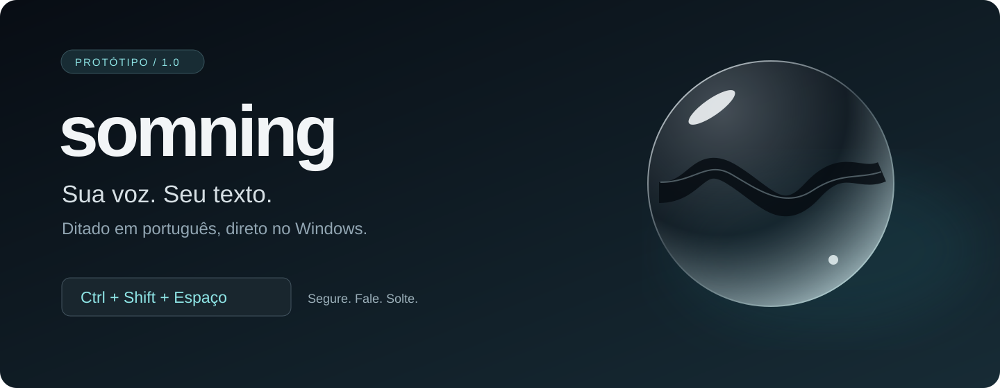
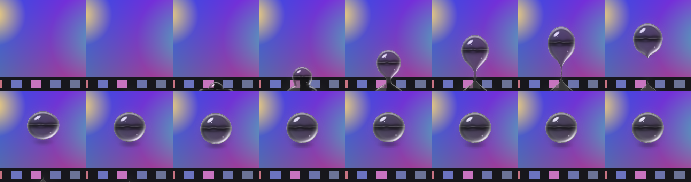
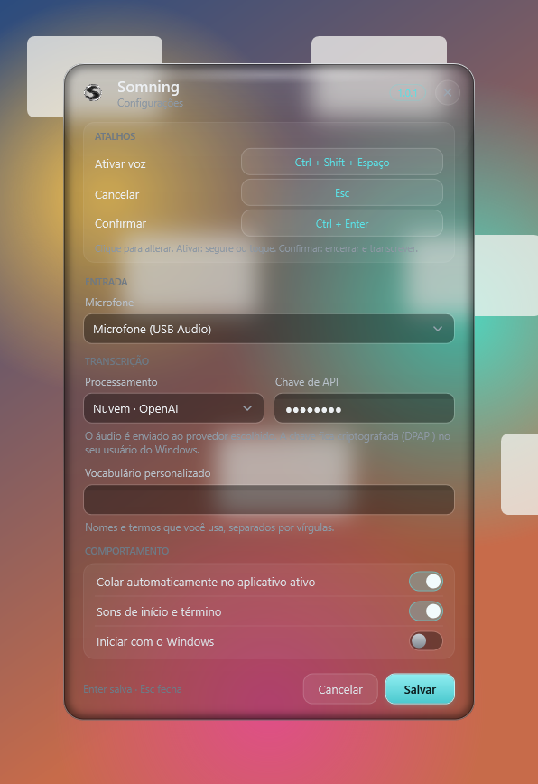

<p align="center">
  
</p>



<p align="center">
  <strong>Windows 10 x64 · Português do Brasil · Whisper local · Protótipo 1.0</strong>
</p>

<p align="center">
  <a href="#como-funciona">Como funciona</a> ·
  <a href="#instalação">Instalação</a> ·
  <a href="#desenvolvimento">Desenvolvimento</a> ·
  <a href="docs/PRIVACIDADE.md">Privacidade</a>
</p>

O **Somning** transforma sua fala em texto no campo em que você está trabalhando. Segure **Ctrl + Shift + Espaço**, fale e solte. A transcrição fica na área de transferência e pode ser colada automaticamente no aplicativo ativo.

O processamento local usa **Whisper**, em um processo separado. Depois de baixar os modelos, você pode ditar offline. **Groq** e **OpenAI** são opções de nuvem ativadas por você, com sua própria chave.

> **Versão 1.0 do protótipo.** O fluxo de ditado está implementado; aparência nativa, compatibilidade entre aplicativos e fluidez em monitores de alta frequência continuam em validação. Veja as [limitações conhecidas](docs/RELEASE-1.0.md).

## Como funciona

| 1. Segure | 2. Fale | 3. Solte |
| :--- | :--- | :--- |
| Pressione **Ctrl + Shift + Espaço** no campo de destino. | A gota de vidro acompanha o nível da sua voz. | O Somning transcreve, copia e tenta colar o texto. |

Um toque curto no atalho também permite alternar a gravação. Se a colagem automática não ocorrer, use **Ctrl+V**: o texto continua na área de transferência.



*Prévia renderizada da animação real: a gota emerge da borda inferior, reage à voz e muda de estado durante a transcrição. A imagem estática não representa uma medição de FPS.*

## Uma interface que fica fora do caminho

O aplicativo permanece na **bandeja do Windows**. O menu dá acesso às configurações, à colagem da última transcrição, aos logs e à saída do programa.

<p align="center">
  
</p>

*Interface WPF atual renderizada fora da tela sobre um papel de parede sintético. A transparência é simulada nessa prévia; o resultado no desktop depende da composição do Windows.*

| Recurso | No protótipo |
| :--- | :--- |
| Ditado em pt-BR | Whisper local, com modelos baixados separadamente |
| Atalho global | Segurar para falar ou toque para alternar |
| Destino do texto | Área de transferência e colagem automática configurável |
| Microfone e vocabulário | Seleção de dispositivo e termos personalizados |
| Nuvem opcional | Groq ou OpenAI, com chave protegida pelo Windows via DPAPI |
| Preferências | Sons, colagem e inicialização com o Windows |
| Indicador de voz | Vidro grafite, ondas reativas e efeito de lente |

## Instalação

**Requisitos:** Windows 10 x64, microfone e espaço para o aplicativo e os modelos. O modelo principal ocupa aproximadamente 574 MB. O pacote inclui o runtime .NET; o uso do aplicativo não exige o SDK.

Baixe **Somning-1.0.0-Setup.exe** na [Release 1.0](https://github.com/JotaEfi/somning/releases/tag/v1.0.0-prototype.1) e siga o assistente. A instalação é por usuário e inclui desinstalador. Os modelos são baixados separadamente pelo atalho **Somning - Baixar modelos** no Menu Iniciar. O código-fonte também está disponível em um ZIP separado na mesma release.

Se preferir o pacote ZIP do aplicativo:

1. Extraia todo o conteúdo, preservando a pasta `engine`.
2. Execute **`Instalar.cmd`** para instalar por usuário.
3. Execute **`Baixar-modelos.cmd`** e aguarde a preparação dos modelos.
4. Abra **Somning** no Menu Iniciar e faça seu primeiro ditado.

Os binários ainda não têm assinatura digital. Os detalhes de instalação, atualização e remoção estão no [guia de instalação](docs/INSTALACAO.md).

## Seus dados

- **Modo local:** a transcrição roda no computador, sem envio a um provedor de transcrição.
- **Modo nuvem:** o áudio é enviado ao provedor que você escolher.
- **Chaves:** protegidas por DPAPI no usuário do Windows.
- **Área de transferência:** o texto permanece disponível para colagem manual.

Consulte [Privacidade e armazenamento](docs/PRIVACIDADE.md) para saber onde ficam configurações, logs, modelos e áudios preservados após falhas. Revise os logs antes de compartilhá-los em uma issue.

## Desenvolvimento

A solução usa **C# / .NET 10**, WPF e APIs Win32. O mecanismo Whisper roda em `Somning.Engine`, separado do aplicativo.

```text
src/
  Somning.App/                Orquestração do ditado e aplicativo
  Somning.Core/               Regras e estados independentes da interface
  Somning.Engine/             Processo de transcrição local
  Somning.Engine.Protocol/    Comunicação entre aplicativo e motor
  Somning.Platform.Windows/   Áudio, atalhos, bandeja, vidro e colagem
 tests/                      Testes Core, integração e fixtures
 tools/                      Empacotamento, modelos e prévias
```

No Windows, com o SDK definido em `global.json`:

```powershell
git clone https://github.com/JotaEfi/somning.git
cd somning
dotnet build Somning.sln -c Release -warnaserror
dotnet test --project tests/Somning.Core.Tests -c Release
dotnet run --no-build --project src/Somning.App -c Release
```

Para gerar o ZIP com runtime e scripts de instalação:

```powershell
powershell -NoProfile -File tools/package.ps1
```

Para gerar o Setup.exe, instale Inno Setup 6 e execute `powershell -NoProfile -File tools/setup.ps1` após o empacotamento.

Saída: `publish/Somning-1.0.0-win-x64.zip`, com checksum `.sha256` ao lado. Modelos não são incluídos. Não distribua builds Debug nem pacotes com `-WithHarness`.

**Testes de integração:** alguns usam foco, teclado e desktop real. Execute esses casos apenas em uma sessão dedicada; não rode toda a suíte enquanto usa o computador.

## Estado da versão 1.0

O build Release foi validado com avisos tratados como erros. A última execução completa dos testes Core passou com **367 testes**; os **11 testes de configurações sem interação com o desktop** também passaram. Esses números não significam cobertura de todos os aplicativos ou aprovação visual do Windows real.

A colagem em Word, alvos elevados/UIPI e outros cenários do desktop tem ressalvas. Instalação em máquina limpa, DPI e comportamento após suspensão/logon ainda exigem verificação. Os detalhes estão nas [notas do protótipo](docs/RELEASE-1.0.md) e no [changelog](CHANGELOG.md).

Encontrou um problema? [Abra uma issue](https://github.com/JotaEfi/somning/issues) com versão do Windows, passos para reproduzir e resultado esperado. Não envie gravações pessoais, chaves ou logs sem revisão.

## Créditos e licença

O logo oficial é **S onda**. A alternativa **S fluido** está preservada para um possível rebranding; veja a [documentação da marca](src/Somning.Platform.Windows/Branding/README.md).

As dependências e seus avisos estão em [Componentes de terceiros](docs/TERCEIROS.md).

**Ainda não há licença aberta definida para este código.** A disponibilização pública permite consultar o protótipo, mas não concede uma licença aberta por inferência. As licenças dos componentes de terceiros continuam aplicáveis.