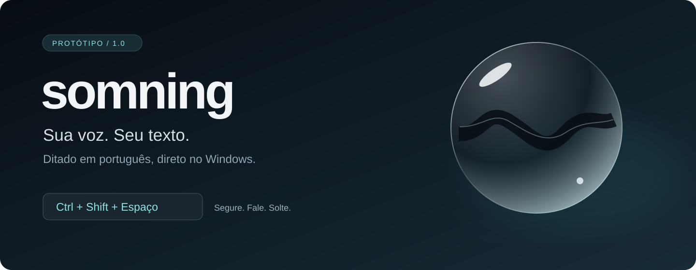
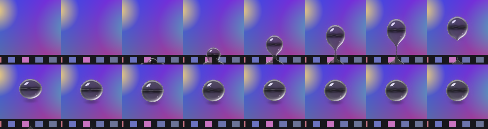
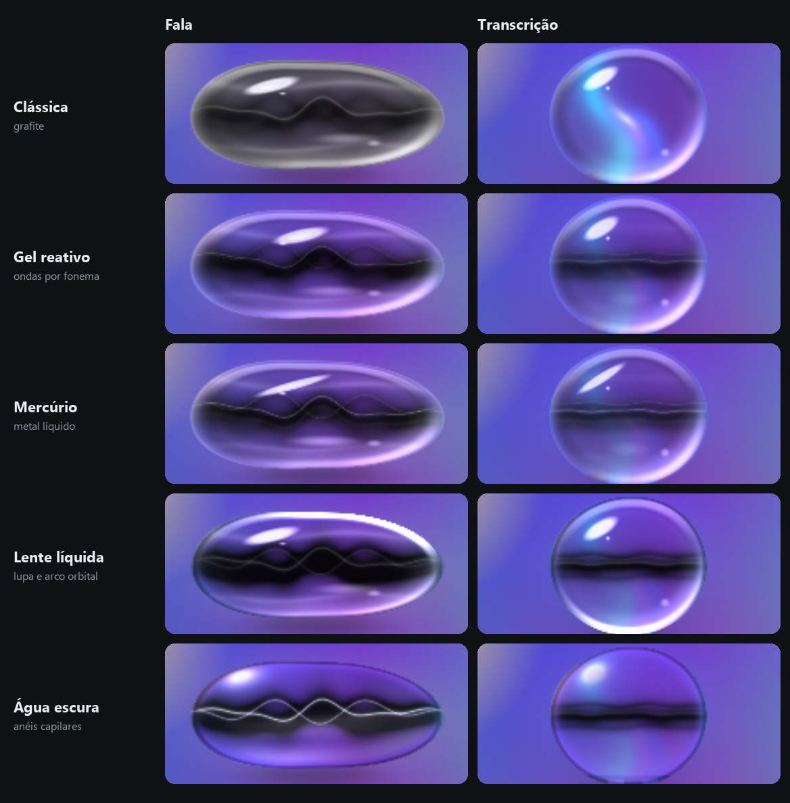
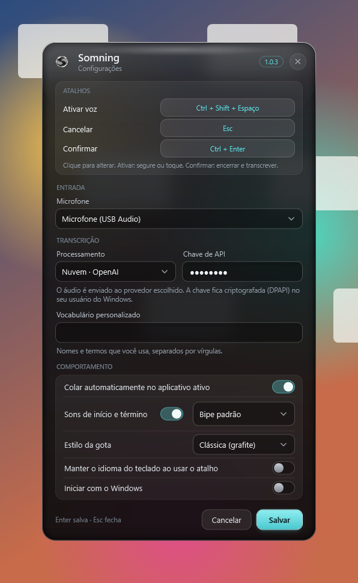

<p align="center">
  
</p>



<p align="center">
  <strong>Windows 10 e 11 · x64 e ARM64 · Português do Brasil · Whisper local · Protótipo 1.0.3</strong>
</p>

<p align="center">
  <a href="https://github.com/JotaEfi/somning/actions/workflows/build.yml"></a>
  
  
  
  
  
</p>

<p align="center">
  <a href="#como-funciona">Como funciona</a> ·
  <a href="#estilos-da-gota">Estilos da gota</a> ·
  <a href="#instalação">Instalação</a> ·
  <a href="#desenvolvimento">Desenvolvimento</a> ·
  <a href="docs/PRIVACIDADE.md">Privacidade</a>
</p>

O **Somning** transforma sua fala em texto no campo em que você está trabalhando. Segure **Ctrl + Shift + Espaço**, fale e solte. A transcrição fica na área de transferência e pode ser colada automaticamente no aplicativo ativo.

O processamento local usa **Whisper**, em um processo separado. O instalador baixa os modelos (cerca de 1,45 GB); depois disso, você pode ditar offline. **Groq** e **OpenAI** são opções de nuvem ativadas por você, com sua própria chave.

> **Versão 1.0.3 do protótipo.** O fluxo de ditado está implementado; aparência nativa, compatibilidade entre aplicativos e fluidez em monitores de alta frequência continuam em validação. As compilações para **Windows 11** e **ARM64** existem, mas ainda não foram validadas em hardware real. Veja as [limitações conhecidas](docs/RELEASE-1.0.md).

## Como funciona

| 1. Segure | 2. Fale | 3. Solte |
| :--- | :--- | :--- |
| Pressione **Ctrl + Shift + Espaço** no campo de destino. | A gota de vidro acompanha o nível, o tom e o ritmo da sua voz. | O Somning transcreve, copia e tenta colar o texto. |

Um toque curto no atalho também permite alternar a gravação. Em **Configurações → Atalhos**, clique na ação e pressione a combinação desejada. O padrão para ativar é **Ctrl + Shift + Espaço**; **Esc** cancela a gravação e **Ctrl + Enter** confirma, encerrando a gravação para transcrever. As três combinações devem ser diferentes e mudam ao salvar. Os atalhos ficam suspensos enquanto as configurações estão abertas para você editá-los sem iniciar um ditado. Se a colagem automática não ocorrer, use **Ctrl+V**: o texto continua na área de transferência.



*Prévia renderizada da animação real: a gota emerge da borda inferior, reage à voz e muda de estado durante a transcrição. A imagem estática não representa uma medição de FPS.*

## Estilos da gota

A gota é desenhada pelo próprio Somning, em software, sem GPU. Em **Configurações → Estilo da gota** você escolhe entre cinco estilos, e a troca vale na hora, sem reiniciar. Todos têm no centro a **faixa escura reativa à voz**, com as linhas finas que serpenteiam a cada fonema, e todos têm uma **bolha de transcrição do mesmo estilo**: a mesma gota, com o fluxo calmo de ciano e violeta por cima.



*Prévia renderizada pelo motor visual do Somning sobre um fundo sintético, com voz forte. A imagem é estática: o movimento real depende da sua voz e do tom.*

| Estilo | Característica |
| :--- | :--- |
| **Clássica** (padrão) | Vidro grafite com a faixa escura e o efeito de lente. |
| **Gel reativo** | Gel translúcido; ondas da borda ao centro a cada fonema deformam o fundo e as linhas. |
| **Mercúrio** | Acabamento metálico prateado, com mercúrio escuro no centro e janela de brilho alongada. |
| **Lente líquida** | Lupa central, faixa mais marcada e um arco de brilho que orbita a borda, guiado pelo tom. |
| **Água escura** | Água clara com a sombra de uma água funda no centro, que ondula com anéis a cada ataque de voz. |

Todos reagem ao **volume**, ao **tom** (agudo e grave deslocam os reflexos) e ao **impacto** de cada início de fala. A forma e o movimento são os mesmos nos cinco estilos; muda só a pintura.

## Uma interface que fica fora do caminho

O aplicativo permanece na **bandeja do Windows**. O menu dá acesso às configurações, à colagem da última transcrição, aos logs e à saída do programa.

<p align="center">
  
</p>

*Interface WPF atual renderizada fora da tela sobre um papel de parede sintético. A transparência é simulada nessa prévia; o resultado no desktop depende da composição do Windows.*

| Recurso | No protótipo |
| :--- | :--- |
| Ditado em pt-BR | Whisper local, com modelos baixados separadamente |
| Atalhos globais | Combinações independentes para ativar, cancelar e confirmar |
| Destino do texto | Área de transferência e colagem automática configurável |
| Microfone e vocabulário | Seleção de dispositivo e termos personalizados |
| Nuvem opcional | Groq ou OpenAI, com chave protegida pelo Windows via DPAPI |
| Preferências | Temas de som, colagem e inicialização com o Windows |
| Indicador de voz | Cinco estilos de gota de vidro, reativos a volume, tom e impacto |
| Plataformas | Windows 10 e 11, em x64 e ARM64 (instaladores separados) |

## Instalação

**Requisitos:** Windows 10 ou 11, microfone e espaço para o aplicativo e os modelos. O modelo principal ocupa aproximadamente 574 MB. O pacote inclui o runtime .NET; o uso do aplicativo não exige o SDK.

Baixe o instalador da sua arquitetura na [release mais recente](https://github.com/JotaEfi/somning/releases/latest) e siga o assistente:

| Seu computador | Arquivo |
| :--- | :--- |
| PC com processador Intel ou AMD (x64) | **Somning-1.0.3-Setup.exe** |
| PC com processador ARM (Snapdragon e similares) | **Somning-1.0.3-arm64-Setup.exe** |

A instalação é por usuário e inclui desinstalador. O instalador baixa os modelos durante a instalação; se o download não terminar, o atalho **Somning - Baixar modelos** no Menu Iniciar completa depois. O código-fonte também está disponível em um ZIP separado na mesma release.

**Em ARM64** o processamento local roda na CPU: o Whisper não tem aceleração por GPU (Vulkan) para essa arquitetura, então o ditado é mais lento que em um PC x64 com placa de vídeo compatível.

**Instalação silenciosa:** o instalador fecha o Somning e o motor sozinho se estiverem abertos.

```powershell
.\Somning-1.0.3-Setup.exe /VERYSILENT /SUPPRESSMSGBOXES /NORESTART /SEMMODELOS=1
```

Use `/SEMMODELOS=1` para pular o download dos modelos e `/DIR="C:\Pasta"` para escolher a pasta. Sem `/DIR`, uma atualização reaproveita a pasta da instalação anterior.

Se preferir o pacote ZIP do aplicativo:

1. Extraia todo o conteúdo, preservando a pasta `engine`.
2. Execute **`Instalar.cmd`**: ele baixa os modelos e instala por usuário.
3. Se os modelos não tiverem sido baixados, execute **`Baixar-modelos.cmd`** e aguarde.
4. Abra **Somning** no Menu Iniciar e faça seu primeiro ditado.

Os binários ainda não têm assinatura digital, então o Windows SmartScreen pode exibir um aviso. Os detalhes de instalação, atualização e remoção estão no [guia de instalação](docs/INSTALACAO.md).

## Seus dados

- **Modo local:** a transcrição roda no computador, sem envio a um provedor de transcrição.
- **Modo nuvem:** o áudio é enviado ao provedor que você escolher.
- **Chaves:** protegidas por DPAPI no usuário do Windows.
- **Área de transferência:** o texto permanece disponível para colagem manual.

Consulte [Privacidade e armazenamento](docs/PRIVACIDADE.md) para saber onde ficam configurações, logs, modelos e áudios preservados após falhas. Revise os logs antes de compartilhá-los em uma issue.

## Desenvolvimento

A solução usa **C# / .NET 10**, WPF e APIs Win32. O mecanismo Whisper roda em `Somning.Engine`, separado do aplicativo.

```text
src/
  Somning.App/                Orquestração do ditado e aplicativo
  Somning.Core/               Regras, estados e física da gota, sem interface
  Somning.Engine/             Processo de transcrição local
  Somning.Engine.Protocol/    Comunicação entre aplicativo e motor
  Somning.Platform.Windows/   Áudio, atalhos, bandeja, vidro, colagem e pintura da gota
tests/                        Testes Core, integração e fixtures
tools/                        Empacotamento, modelos e prévias
docs/                         Guias, imagens e marca
```

No Windows, com o SDK definido em `global.json`:

```powershell
git clone https://github.com/JotaEfi/somning.git
cd somning
dotnet build Somning.sln -c Release -warnaserror
.\tests\Somning.Core.Tests\bin\Release\net10.0\Somning.Core.Tests.exe
dotnet run --no-build --project src/Somning.App -c Release
```

### Empacotar e gerar o instalador

Cada arquitetura tem o seu pacote e o seu instalador. Compilar o ARM64 num PC x64 funciona, porque o pacote é publicado como independente (*self-contained*):

```powershell
powershell -NoProfile -File tools/package.ps1                # x64   -> publish/package
powershell -NoProfile -File tools/package.ps1 -Arch arm64    # ARM64 -> publish/package-arm64
```

Para gerar o Setup.exe, instale o [Inno Setup 6](https://jrsoftware.org/isinfo.php) e execute, após o empacotamento correspondente:

```powershell
powershell -NoProfile -File tools/setup.ps1                  # Somning-1.0.3-Setup.exe
powershell -NoProfile -File tools/setup.ps1 -Arch arm64      # Somning-1.0.3-arm64-Setup.exe
```

A saída fica em `publish/`, com checksum `.sha256` ao lado. Modelos não são incluídos. Não distribua builds Debug nem pacotes com `-WithHarness`.

### Adicionar um estilo de gota

Cada estilo é um arquivo próprio, `DropRenderer.Style.<Id>.cs`, que pinta **a gota de fala e a de transcrição**. Para criar um:

1. Registre o id e o nome em `Somning.Core/Overlay/DropStyles.cs`.
2. Acrescente o ramo no despachante `DropRenderer.Styles.cs` e crie o arquivo do estilo.
3. Gere a prévia com `SOMNING_DROP_STYLE=<id>` e a ferramenta `tools/Somning.OverlayPreview`.
4. Rode `DropStyleContractTests`: o contrato exige a **faixa escura no centro**, reação à voz e uma bolha de transcrição que seja a mesma gota. Os estilos novos são testados automaticamente.

A física da gota (volume, tom, impacto, ondas) é compartilhada e mora em `Somning.Core`; o estilo só decide como pintá-la.

**Testes de integração:** alguns usam foco, teclado e desktop real. Execute esses casos apenas em uma sessão dedicada; não rode toda a suíte enquanto usa o computador. Os testes de renderização da gota e das configurações não interagem com o desktop.

## Estado da versão 1.0

O build Release é validado com avisos tratados como erros. A última execução dos testes Core passou com **394 testes**, e os testes de renderização da gota, do contrato dos estilos e das configurações passaram sem interação com o desktop. Esses números não significam cobertura de todos os aplicativos ou aprovação visual do Windows real.

**Ainda não validado:** os instaladores para **ARM64** e a execução no **Windows 11** nunca rodaram em hardware real; as prévias da gota foram avaliadas em imagens com fala sintética, não em movimento com microfone; a colagem em Word, alvos elevados/UIPI e outros cenários do desktop têm ressalvas. Instalação em máquina limpa, DPI e comportamento após suspensão/logon também exigem verificação. Os detalhes estão nas [notas do protótipo](docs/RELEASE-1.0.md) e no [changelog](CHANGELOG.md).

Encontrou um problema? [Abra uma issue](https://github.com/JotaEfi/somning/issues/new/choose) com versão do Windows, arquitetura (x64 ou ARM64), passos para reproduzir e resultado esperado. Não envie gravações pessoais, chaves ou logs sem revisão. Falhas de segurança seguem a [política de segurança](SECURITY.md). Quer contribuir? Leia o [guia de contribuição](CONTRIBUTING.md) e o [código de conduta](CODE_OF_CONDUCT.md).

## Créditos e licença

O logo oficial é **S onda**. A alternativa **S fluido** está preservada para um possível rebranding; veja a [documentação da marca](docs/branding/README.md).

As dependências e seus avisos estão em [Componentes de terceiros](docs/TERCEIROS.md).

O código do Somning é distribuído sob a [licença MIT](LICENSE). As licenças dos componentes de terceiros continuam aplicáveis.
