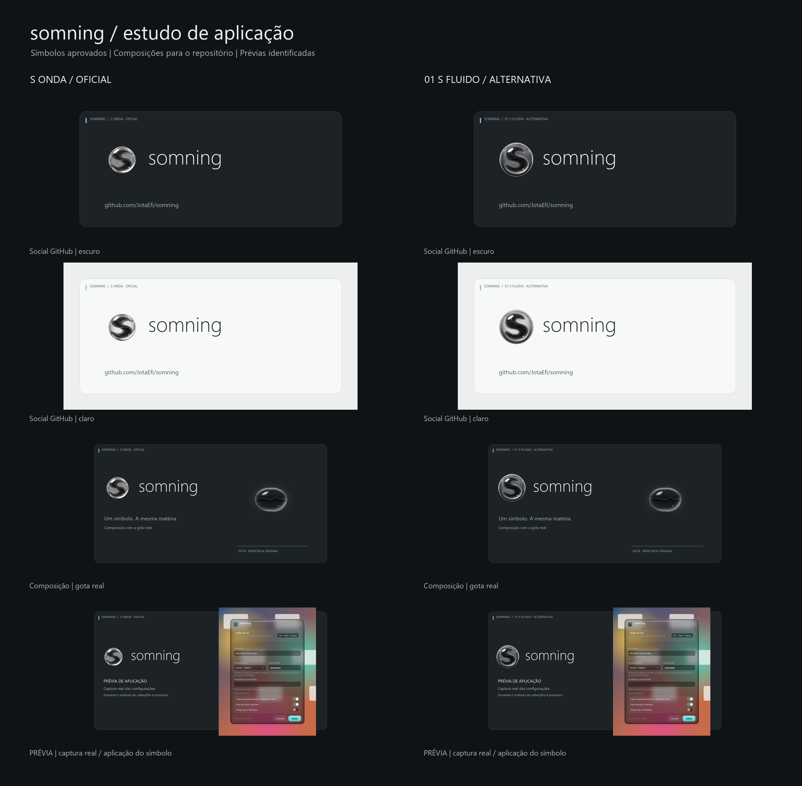

# somning — aplicações de marca

**S onda é a marca oficial. 01 S fluido é uma alternativa**, apresentada para comparação; sua presença neste pacote não altera a identidade do aplicativo.

## Organização

- `onda/`: símbolos aprovados, lockups e aplicações da versão oficial.
- `fluido/`: o mesmo conjunto para a alternativa 01 S fluido.
- `shared/`: cópias das referências reais e registro SHA-256 dos símbolos de 512 px.
- `board.png`: comparativo; use os arquivos individuais para publicação, preservando a proporção.

## Arquivos por versão

| Arquivo | Uso |
| --- | --- |
| `logo-isolado-512.png` | Símbolo transparente de 512 × 512; cópia exata da fonte aprovada |
| `logo-isolado-original.png` | Fonte original transparente; dimensões originais preservadas |
| `lockup-{claro,escuro}-transparente.{png,svg}` | Símbolo ao lado do nome; 1100 × 260; escolha conforme o fundo |
| `quadrado-1080-{claro,escuro}.{png,svg}` | Postagem quadrada; 1080 × 1080 |
| `retangular-1600x900-{claro,escuro}.{png,svg}` | Apresentação horizontal; 1600 × 900 |
| `github-1280x640-{claro,escuro}.{png,svg}` | Imagem social do repositório; 1280 × 640 |
| `composicao-gota-{claro,escuro}.{png,svg}` | Símbolo e gota real; 1600 × 900 |
| `previa-aplicativo-{claro,escuro}.{png,svg}` | Prévia explicitamente identificada; 1600 × 900 |

`claro` e `escuro` indicam o fundo de destino; o lockup correspondente usa texto escuro ou claro, respectivamente. Os símbolos nunca são recoloridos. Para GitHub, selecione um PNG `github-1280x640`; a versão onda é a opção oficial.

## Direção e edição

Grafite, contraste suave, formas de vidro dos símbolos originais, superfícies discretas e acento ciano mínimo. Palavra `somning` em Segoe UI Light; rótulos em Segoe UI. As fontes não são redistribuídas. Instale essas fontes para editar com fidelidade; outro editor pode aplicar substituição tipográfica.

Os SVGs são composições editáveis e autossuficientes: texto, posições e superfícies podem ser editados; os símbolos e capturas são PNGs incorporados, **não vetores redesenhados**. Preserve proporção, cores e transparência dos símbolos; não estique, trace, aplique filtros ou reconstrua suas curvas. Para publicar com tipografia fixa, prefira os PNGs. Não há necessidade de imagegen: esta entrega usa composição nativa de material aprovado.

## Referências e limites das prévias

- Onda: `src/Somning.Platform.Windows/Branding/Sources/s-onda-{original,512}.png`.
- Fluido: `src/Somning.Platform.Windows/Branding/Future/s-fluido-{original,512}.png`.
- Configurações: `docs/images/settings.png`, copiada em `shared/settings-real.png`. A captura permanece em tamanho nativo na composição. Apenas a área do símbolo no cabeçalho recebe uma sobreposição proposta; ela não representa uma alteração implementada no aplicativo. A pequena base grafite nessa área faz parte da prévia.
- Gota: `../somning-logos/referencia-gota/gota-ouvindo-6x-alpha-01.png`, copiada em `shared/gota-real.png`, sem redesenho; ampliação já presente na referência.
- Animação real: `docs/images/voice-animation.png`, preservada em `shared/voice-animation-real.png` como referência visual da gota em contexto.

As prévias não acrescentam telas ou funcionalidades. Não há alegação de desempenho ou de taxa de quadros. Os fundos claro e escuro pertencem às peças de apresentação; a captura real mantém seu próprio tema e conteúdo.

## Conferência

32 PNGs e 24 SVGs. Dimensões de publicação conferidas; SVGs analisados como XML; símbolos isolados comparados byte a byte com as quatro fontes autorizadas. Arquivos restritos a `docs/branding/`; registros GSD, commits e publicação permanecem com o maestro.
